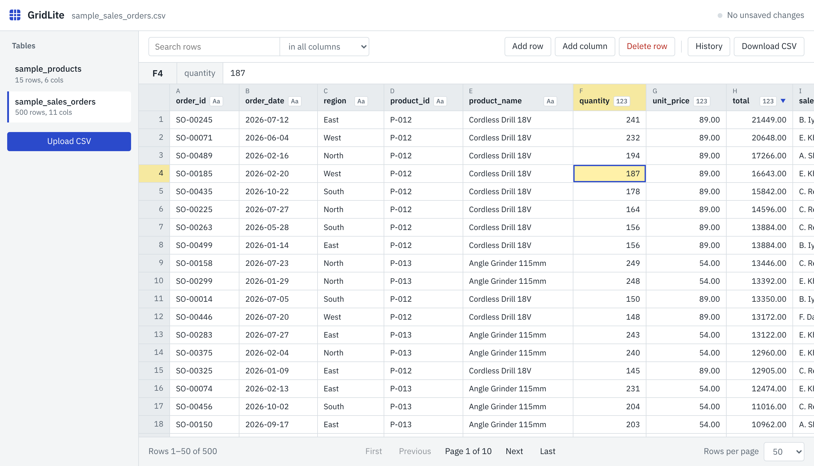

# GridLite — local CSV editor (cross-platform repair edition)

GridLite is a lightweight browser-based editor for CSV files: React/Vite UI,
Node.js/Express gateway, and Python/Flask/pandas data service. Every successful
edit is saved to the local CSV; no cloud or database is used.

> **For Windows:** start with [docs/WINDOWS.md](docs/WINDOWS.md) and run the
> included diagnostic script. This code has not yet been run on a real Windows
> machine by this reviewer; Windows/macOS CI is included for your repository.



## Get the code

```bash
git clone https://github.com/akshatkumbhat/gridlite.git
cd gridlite
```

## Requirements

- **Node.js 24.x** (`.nvmrc`) and npm (root, gateway and web lockfiles included).
- **Python 3.12** in `api/.venv` (never copy the virtual environment between OSes).
- Try it on sample data or copies of your files first.

## macOS/Linux first setup

```bash
python3.12 -m venv api/.venv
api/.venv/bin/python -m pip install -r api/requirements.txt
npm run install:all
```

## Windows PowerShell first setup

```powershell
py -3.12 -m venv api\.venv
.\api\.venv\Scripts\python.exe -m pip install -r api\requirements.txt
npm run install:all
```

## Launch and tests (same commands on every OS)

```bash
npm run test:all   # backend API tests, JavaScript API-client tests, Vite build
npm run dev        # open http://localhost:5173
```

For one-port demo mode run `npm run build`, then `npm start`, and open
http://localhost:4000. Ctrl+C stops the development services.

## Features

- List/upload CSV files, search, numeric/text sort, page through 25–200 rows.
- Edit cells via Enter/Tab, cancel via Esc, clear via Delete; view long values.
- Add/delete rows, add columns, inspect change history and download a CSV.
- Every mutation checks the **SHA-256 version** from the last table read. If
  another tool has modified the CSV, it refuses the stale edit (HTTP 409).
- Back up before file replacement; keep the latest 5 backups per table.
- Preserve UTF-8/UTF-8 BOM/Latin-1, line endings, blank physical lines, whether
  the file ends in a newline, and fully quoted CSV export style.
- Reject duplicate column headers and inconsistent numeric input such as
  `1_000` in a number column.

## API change in this edition (important)

`GET /api/tables/<name>/rows` includes a `version` hash. **All edits must send
that hash in `If-Match`** (PATCH cell, POST row, DELETE row, POST column). A
successful edit returns the new hash. Missing token returns 428; a stale token
returns 409. The bundled frontend supports this automatically. Existing custom
scripts using the old API must be updated. Details: [docs/API.md](docs/API.md).

Row IDs are file positions (0-based) and are **renumbered on deletion or reload**.
The version check prevents a stale row number from editing a different record;
it does not make this suitable for shared access.

## File handling policy

- CSV files belong in `data/`; only sample data should enter Git.
- **No undo button yet.** Backups in `data/backups/` are the recovery path.
- The writer preserves `QUOTE_ALL` style for entirely quoted files, but mixed
  cell-by-cell quoting is normalized on editing. Do not use it on data where an
  external consumer depends on the exact original CSV bytes without additional
  compatibility checks.
- Saves still rewrite the entire file. Large datasets need performance testing.
- Single-user local use only; no login or team-safe transactions.

## Source map

- `api/storage.py` — CSV reading/writing, format preservation, backup and version guard.
- `api/app.py` and `api/tests/` — Flask routes and Python regression tests.
- `gateway/server.js` — Express proxy, health endpoint, compiled-UI serving.
- `web/src/` — React UI, cell editor and API client.
- `web/tests/` — JavaScript API-client regression tests.
- `scripts/py.js` — portable Windows/macOS/Linux Python environment selection.
- `.github/workflows/ci.yml` — Windows, macOS, Linux checks once pushed to GitHub.
- `docs/WINDOWS.md` — detailed Windows instructions.

## Limitations and project provenance

GridLite was received as a reviewed ZIP. The 17 original Python tests were
reported passing on the Mac by the previous reviewer. This edition changes the
API to reject stale edits, adds regression tests and updates its CSV writer.
The original [`docs/DEVLOG.md`](docs/DEVLOG.md) is historical and predates
these changes. See [docs/REPAIR_REPORT.md](docs/REPAIR_REPORT.md) for this
edition's tested and untested areas.

## License

MIT. See [LICENSE](LICENSE).
